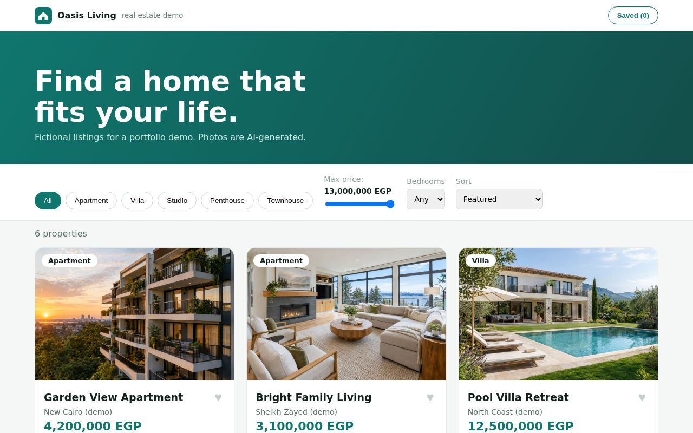
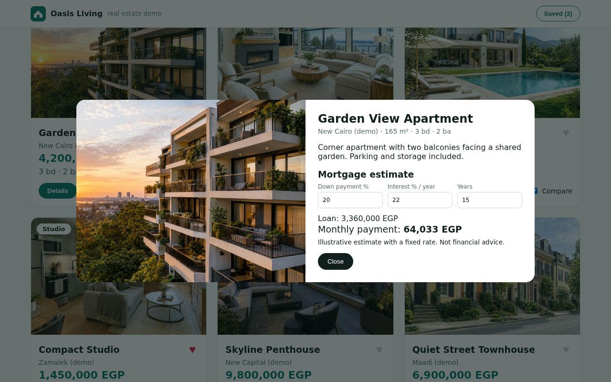

# Oasis Living (React + Vite)

A real-estate listings demo for a fictional agency. Listings, areas and prices are invented demo data. Photos are AI-generated.

## Features
- Filters: property type, max price slider, minimum bedrooms; sort by price or size; empty state
- Save favourites (kept in the browser) and a "Saved" view
- Compare up to 3 properties side by side, with price per m²
- Property details with a mortgage estimate (down payment, interest, years)
- Responsive layout

## Mortgage maths
Fixed-rate formula `M = P·r / (1 − (1+r)^−n)`, `r` = annual rate / 12, `n` = months. A 0% rate uses `P / n`. Years are limited to 1-30. The result is an illustration only, not financial advice.

## Run
```bash
npm install
npm run dev
npm run build
```

## Preview



Short walkthrough video: [docs/demo.mp4](docs/demo.mp4)

## Tests
Headless Chrome checks: type, bedroom and price filters, empty state, sorting, favourites persisting after reload, compare cap of 3, mortgage result against an independent calculation, 0% rate, years clamp, mobile overflow, console errors.
